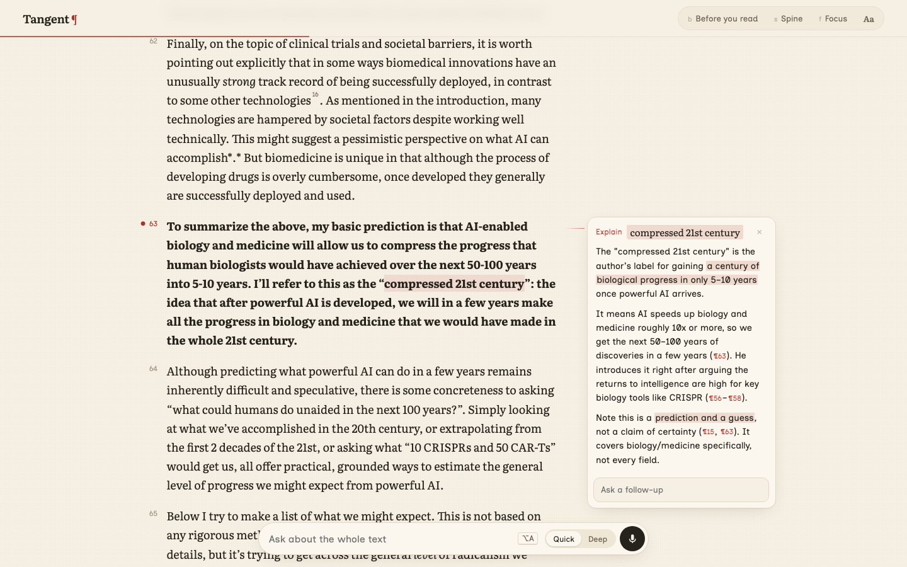

# Tangent

**Go off on a tangent without losing your place.**

Tangent is a reader that answers questions in the margin of whatever you're reading. Select a phrase and ask, or hold <kbd>V</kbd> and ask out loud, and the answer appears beside the words it explains. When you want to go deeper, Tangent writes a short sourced reading on the topic, and breadcrumbs take you back to where you were, with your notes still there.



## What it does

- **Read anything.** Paste a link to an article, PDF, arXiv paper, Wikipedia page or GitHub README. Tangent strips the page down to clean text with real headings, code, tables, maths and footnotes.
- **Ask in the margin.** Select text and start typing, or use Explain, Define or Simplify. Answers stream in within about a second, highlight what matters, and cite the paragraphs they rely on. Follow-ups stay in the same thread.
- **Follow rabbit holes.** Type a question instead of a link and Tangent composes a short reading with sources. Each one ends with questions to read next, and breadcrumbs lead back.
- **Footnotes as sidenotes.** Click a footnote marker and the note opens beside the text instead of at the bottom of the page.
- **Built for readers who find text hard.** A Clear profile with hyperlegible type and spacing; Spine, which sets the core of each sentence in full ink and the details softer; a "Before you read" brief with the gist and key terms; focus mode; a reading ruler; and voice questions.

## Read your own markdown

The `tangent` command opens any markdown file in Tangent. It's handy for reading the docs and plans your coding agent writes. No API keys are needed.

```sh
uv tool install "git+https://github.com/joshuaramkissoon/tangent#subdirectory=cli"

tangent PLAN.md            # opens in your browser and reloads as the file changes
tangent --web PLAN.md      # opens on the hosted site instead, with the file packed into the link
cat notes.md | tangent -   # read from stdin
```

Local mode runs a small server on `127.0.0.1`. It serves the file and any images beside it, and passes questions on to the hosted Tangent. It stops a minute after you close the tab. When the file changes, the page keeps your place, and your margin notes stay as long as their paragraph is unchanged. With `--web`, the file travels in the part of the link after `#`, which browsers never send to a server. Questions you ask still send the text to the model. Set `TANGENT_URL` to use your own deployment.

## Run it

You need [uv](https://docs.astral.sh/uv/) and at least one model key.

```sh
git clone https://github.com/joshuaramkissoon/tangent && cd tangent
cp .env.example .env   # add your keys
uv run server.py       # http://localhost:4317
```

| Key | What it turns on |
| --- | --- |
| `TOGETHER_API_KEY` | Margin answers with DeepSeek V4.1 Flash, plus voice (Whisper) |
| `GEMINI_API_KEY` | Composed readings with Google Search grounding; answers too if there's no Together key |
| `ANTHROPIC_API_KEY` | Optional. Claude writes evergreen deep dives while sources are found in parallel |
| `OPENAI_API_KEY` | Optional. The Decisions API decides whether a question needs a search first |

Every model can be swapped through environment variables; see [`.env.example`](.env.example).

## Deploy

[](https://vercel.com/new/clone?repository-url=https%3A%2F%2Fgithub.com%2Fjoshuaramkissoon%2Ftangent&env=TOGETHER_API_KEY,GEMINI_API_KEY)

The server is a single stateless FastAPI app (`server.py`) and the front end is plain HTML, CSS and JavaScript in `public/`, with no build step. It runs on Vercel as is, or anywhere that runs Python.

A public deployment spends your API credits. Tangent rate-limits each IP address, but on serverless hosts every instance keeps its own counts, so also set a monthly spend limit with each provider.

## How it works

- **Extraction** runs in the browser with Mozilla's [Readability](https://github.com/mozilla/readability). Tangent converts its output into typed blocks (paragraphs, headings, lists, code, tables, images, maths and footnotes). The server only fetches the page, and handles PDFs, arXiv and GitHub itself.
- **Nothing is stored on the server.** The browser holds the document and sends it with each question.
- **Composing a reading:** a quick classifier decides whether the question needs fresh information.
  - If it does, Gemini writes the reading with Google Search grounding.
  - If not, Claude starts writing at once, while a parallel search gathers sources. A small model then attaches citations to each paragraph and flags anything a source explicitly contradicts.

## Licence

MIT. PDF reading uses [PyMuPDF](https://github.com/pymupdf/PyMuPDF), which is AGPL-licensed. If you run a modified Tangent as a public service with PDF support, AGPL terms apply to that deployment. To drop PDF support, run `uv remove pymupdf4llm`.